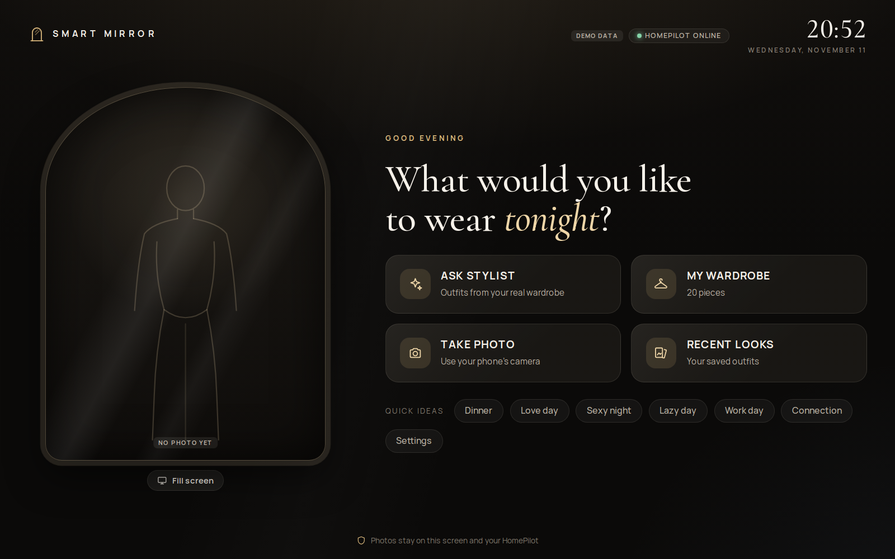
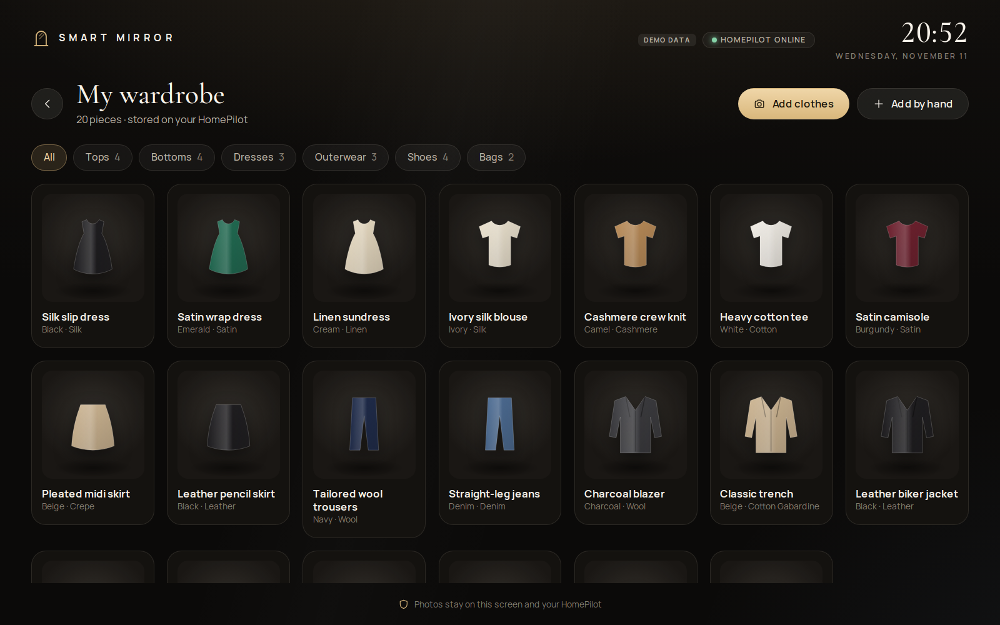
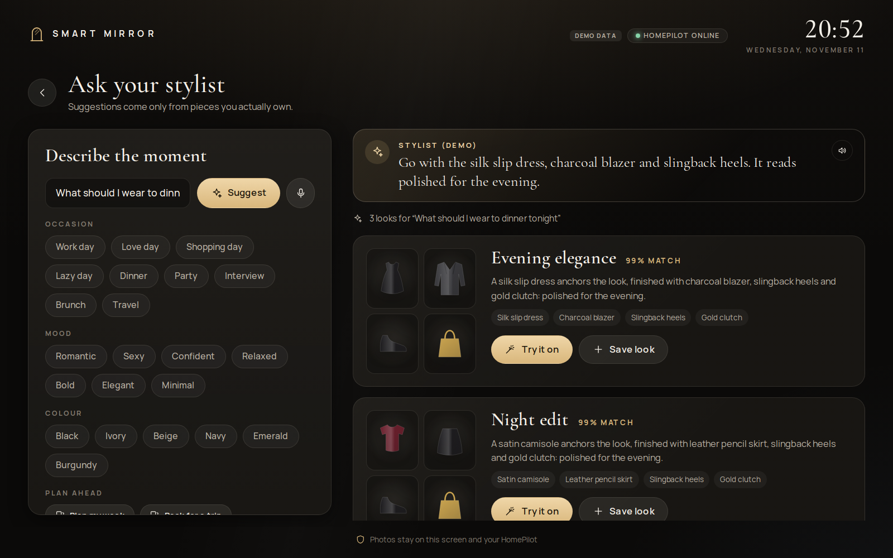
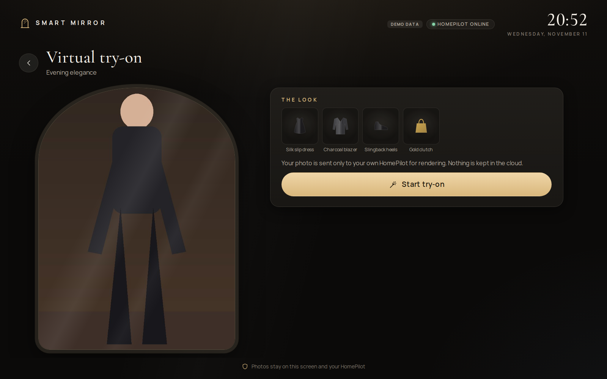
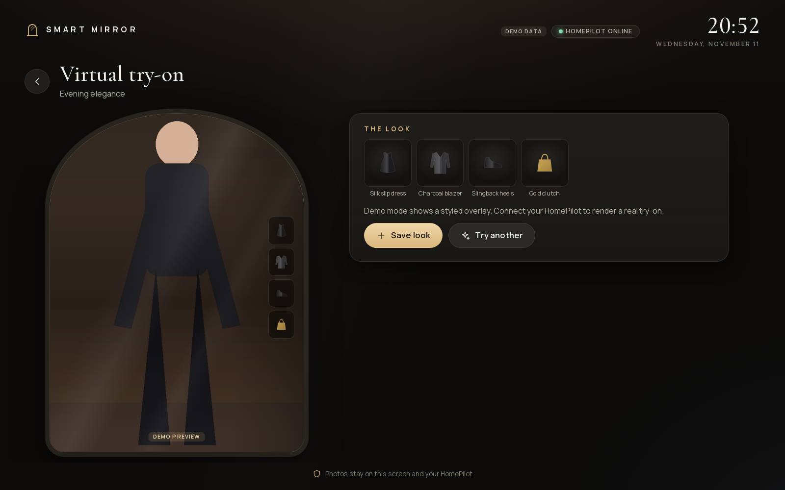
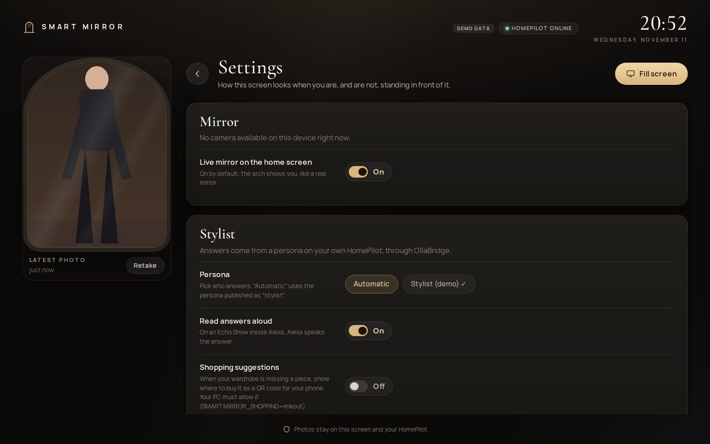

# SmartMirror

SmartMirror is an independent AI wardrobe stylist and virtual try-on application designed for large-screen clients such as Echo Show 21 while remaining fully usable when the Echo camera, microphone, touch input, or direct sideloading are unavailable.

SmartMirror integrates with:

- **HomePilot** for agentic/MCP orchestration and image-editing/AI compute.
- **OllaBridge Cloud** for pairing, owner-scoped identity, remote relay, and temporary media transport.
- **Echo Show / companion clients** as presentation and capture surfaces.

## Design rule

SmartMirror owns wardrobe-specific data and business logic. HomePilot remains a generic AI/compute platform. OllaBridge remains a generic secure transport.

```text
Echo Show / Companion
        |
        | HTTPS + paired device token
        v
 OllaBridge Cloud
        |
        | owner-scoped HomePilot mirror
        v
     HomePilot
        |
        | MCP / Context Forge
        v
    SmartMirror
        |
        +-- PostgreSQL / pgvector
        +-- S3-compatible media
        +-- stylist / ranking
        +-- virtual try-on providers
```

## Web-first UI

The product UI is a Next.js app in `apps/web`, deployed to Vercel. The same
pages run in three places:

```text
                  SmartMirror UI (apps/web, Next.js on Vercel)
                                  │
         ┌────────────────────────┼─────────────────────────┐
         ▼                        ▼                         ▼
   Laptop browser        Echo Show 21 shell         Alexa skill
   /smartmirror          WebView + native bridge    Alexa.Presentation.HTML
                         (apps/echo-show)           (integrations/alexa)
```

A Vercel deployment opens straight into the app and pairs with your
HomePilot through OllaBridge Cloud (`/smartmirror/pairing`). Vercel hosts only
the UI and a thin BFF; wardrobe data, photos and AI jobs stay on your
HomePilot. See `apps/web/README.md` and `docs/adr/0004-web-first-ui.md`.

```bash
pnpm install
pnpm dev        # http://localhost:3000 (demo backend with a sample wardrobe)
```

Open [http://localhost:3000/smartmirror](http://localhost:3000/smartmirror).
With no HomePilot URL configured, the BFF answers from a fixed sample
wardrobe, so every screen is clickable. The header shows **Demo data**.
Photos you take stay in this browser. A try-on in this mode is a styled
overlay on your photo, not a Grok image. A real clothing swap runs only
after this UI is paired with HomePilot and OllaBridge Cloud, and only when
`SMARTMIRROR_GROK_IMAGINE` is on. See
[`docs/architecture/grok-tryon-haul.md`](docs/architecture/grok-tryon-haul.md).

### Home

The home screen is the mirror. The arch is the live view, or a placeholder
until a photo exists. The four actions are the whole product: ask the
stylist, open the wardrobe, take a photo, and reopen a saved look. Quick
ideas fill the stylist prompt (Dinner, Work day, and the rest).



### Wardrobe

**My wardrobe** lists pieces stored for this profile. In the demo those are
the sample clothes (silk slip dress, charcoal blazer, and so on). Filters
count tops, bottoms, dresses, outerwear, shoes, and bags. **Add clothes**
takes a garment photo. **Add by hand** records a piece with no photo, which
the stylist can still name but cannot send to a pixel try-on.



### Stylist

**Ask your stylist** takes one sentence about the moment. Suggestions use
only pieces you own. Each look names the garments, a match score, and two
actions: **Try it on** and **Save look**. In the demo the answer is labelled
**Stylist (demo)** and comes from the local sample ranker. On a paired
HomePilot the same screen calls the published `stylist` persona through
OllaBridge.



### Try-on

**Try it on** opens the look next to your photo. **Start try-on** uploads
that photo to your HomePilot and queues `hp.smartmirror.tryon_create`. In
the demo there is no HomePilot, so after a short wait the screen keeps your
photo, floats the garment tiles on it, and says the overlay is a preview.
Connect HomePilot to render a real swap. With Grok Imagine enabled, that
swap sends your photo plus up to four garment photos through OllaBridge
Cloud. Amazon links stay links: a product page has no pixels to try on.





### Settings

Settings cover the mirror, who answers, and shopping. **Live mirror** shows
the arch on the home screen when this device has a camera. **Persona**
picks Automatic or the demo stylist. **Shopping suggestions** is off until
`SMARTMIRROR_SHOPPING=linkout`. A suggestion is a link and a QR code for
your phone. The mirror does not fetch Amazon pictures.



## Repository status

This repository is an implementation scaffold, not a finished production release. The current code provides the integration contracts and a working development API so HomePilot/OllaBridge integration can be exercised before the advanced ML pipelines are added.

## Quick start

```bash
git clone https://github.com/ruslanmv/SmartMirror.git
cd SmartMirror
cp .env.example .env
docker compose -f infra/compose/docker-compose.yml up --build
```

Health:

```bash
curl http://localhost:8100/health
```

### Hugging Face Space

The API also deploys as a Docker Space: [ruslanmv/SmartMirror](https://huggingface.co/spaces/ruslanmv/SmartMirror) (port 7860). Packaging is in `hf/`; `make space` (or CI **Deploy to Hugging Face Space** on `main`) uploads committed HEAD via `deploy/huggingface/deploy.sh`. Needs repository secret `HF_TOKEN`. See `deploy/huggingface/README.md`.

MCP discovery:

```bash
curl -X POST http://localhost:8100/rpc \
  -H "Content-Type: application/json" \
  -d '{"jsonrpc":"2.0","id":1,"method":"tools/list","params":{}}'
```

Register SmartMirror with a local HomePilot instance:

```bash
export HOMEPILOT_BASE_URL=http://localhost:8000
export HOMEPILOT_API_KEY=your-homepilot-api-key
export SMARTMIRROR_PUBLIC_MCP_URL=http://smartmirror-api:8100/rpc
python scripts/register_homepilot.py
```

The registration helper targets HomePilot's existing additive endpoint:

```text
POST /v1/agentic/register/gateway
```

and registers SmartMirror as an HTTP MCP gateway with tool auto-discovery.

### Stylist persona

The mirror's stylist is a HomePilot persona that you import and publish on your
own HomePilot: [`integrations/homepilot/personas/stylist.hpersona`](integrations/homepilot/personas/stylist.hpersona).
See [the persona README](integrations/homepilot/personas/README.md) for the
three steps (import, publish with alias `stylist`, check `/v1/models`).

## MCP tools

- `hp.smartmirror.wardrobe_list`
- `hp.smartmirror.wardrobe_add`
- `hp.smartmirror.style_suggest`
- `hp.smartmirror.tryon_create`
- `hp.smartmirror.job_get`

The web BFF allow-lists exactly the tools in `packages/contracts/smartmirror-mcp-tools.json`.

The naming follows HomePilot's `hp.` MCP namespace convention.

## REST development API

| Method | Path | Purpose |
|---|---|---|
| GET | `/health` | Service health |
| GET | `/v1/capabilities` | Feature discovery |
| POST | `/v1/wardrobe/items` | Add a wardrobe item |
| GET | `/v1/wardrobe/items` | List wardrobe |
| POST | `/v1/style/requests` | Create an outfit request |
| POST | `/v1/tryon/jobs` | Queue a try-on job |
| GET | `/v1/jobs/{id}` | Poll a job |
| POST | `/rpc` | HomePilot-compatible JSON-RPC MCP endpoint |

## OllaBridge integration

The Python client in `integrations/ollabridge/client.py` uses the existing private HomePilot mirror API:

- `GET /v1/mirror/nodes`
- `POST /v1/mirror/nodes/{node_id}/jobs`
- `GET /v1/mirror/jobs/{job_id}?node_id=...`
- `POST /v1/media/upload`

The Echo/companion client should pair with OllaBridge and hold an OllaBridge device token. It should **not** expose HomePilot or SmartMirror directly to the Internet.

## Echo Show architecture

The Echo client in `apps/echo-show` is a thin WebView shell around the web UI.
It bridges native capture and a capability report through `window.SmartMirrorNative`.

The camera layer is intentionally abstract:

```text
CameraSource
├── EchoShowCamera       experimental
├── CompanionCamera      supported fallback
├── NetworkCamera        supported fallback
└── UploadedPhoto        supported fallback
```

The UI must remain remote/D-pad navigable. Touch, camera, and microphone availability are capability checks, not mandatory assumptions.

## Development

Python:

```bash
python -m venv .venv
source .venv/bin/activate
pip install -e ".[dev]"
pytest
```

Web UI:

```bash
pnpm install
pnpm -r typecheck && pnpm -r test
pnpm dev
```

Echo client:

```bash
cd apps/echo-show
gradle :app:assembleDebug -PsmartmirrorWebUrl=https://smart-mirror.vercel.app
```

## Documentation

- `docs/architecture/overview.md`
- `docs/architecture/homepilot-integration.md`
- `docs/architecture/ollabridge-integration.md`
- `docs/architecture/grok-tryon-haul.md` (Grok Imagine clothing swap and Amazon haul)
- `docs/architecture/wardrobe-intelligence-and-shopping.md` (garment ML, outfit sets, Amazon)
- `docs/plans/homepilot-smartmirror-upgrade-plan.md` (cross-repo delivery plan)
- `docs/privacy/data-handling.md`
- `docs/device-testing/echo-show-21.md`
- `docs/adr/`
- `apps/web/README.md`
- `integrations/alexa/README.md`

## Integration work still required in HomePilot

SmartMirror can already register as a local MCP gateway. For complete remote Echo-to-SmartMirror execution through the private HomePilot mirror, HomePilot should add a generic, allow-listed node-job operation for MCP/agentic invocation and expose image-edit node jobs through its existing compute abstraction. Those changes belong in HomePilot because they are general platform capabilities, not SmartMirror business logic.

See `docs/architecture/homepilot-integration.md`.

## License

Apache License 2.0.
